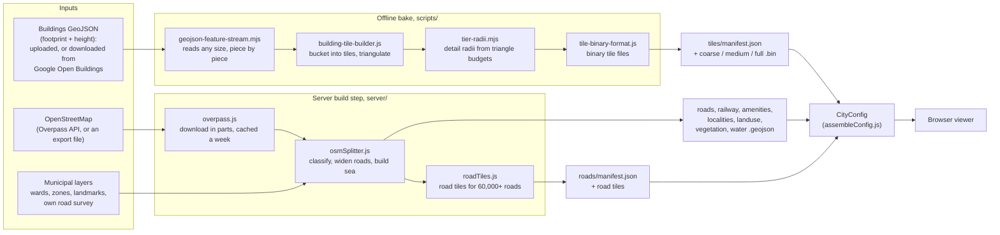
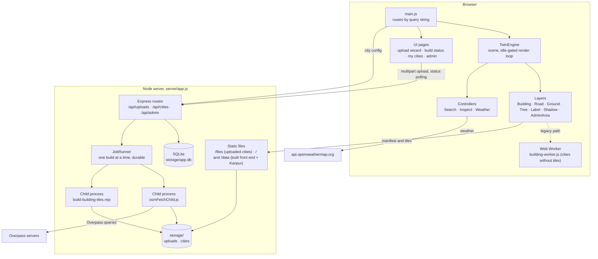
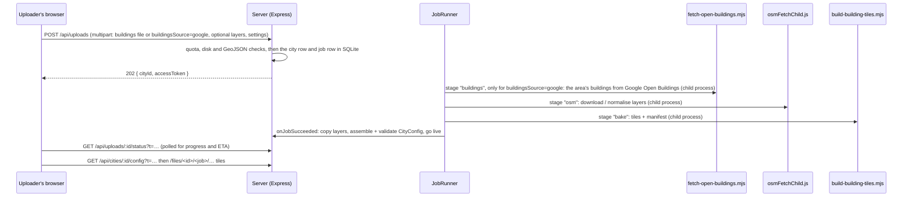

# DigiTwin Generator

DigiTwin Generator turns a city's map data into a **3D digital twin that runs in any desktop web browser**. People fly around the city's buildings, roads, rail, water and parks; click anything to inspect it; search for a place and fly there; and watch the scene follow the real time of day and weather.

It ships with one built-in city, **Kanpur**. Any other city is added from the browser: an uploader draws the area on a map, and either lets the server download its buildings from Google Open Buildings or attaches a buildings file. The self-hosted server downloads everything else from OpenStreetMap, builds the 3D city and publishes it at a private link that can be shared or embedded in another platform, such as AirawatOS.

| You are… | Start here |
|---|---|
| Anyone trying it on their own Windows PC | [Run it on your own Windows PC](#run-it-on-your-own-windows-pc) |
| A product manager or stakeholder | [Part 1 · Product overview](#part-1--product-overview) |
| A GIS specialist preparing or checking data | [Part 2 · The geospatial data pipeline](#part-2--the-geospatial-data-pipeline) |
| A technical lead taking over the code | [Part 3 · Engineering guide](#part-3--engineering-guide) |
| IT deploying it on a server | [HOSTING.md](HOSTING.md) |
| A developer embedding the viewer in another site | [public/EMBED.md](public/EMBED.md) |

Other documents: [server/README.md](server/README.md) (backend, upload flow, admin page) · [NEW_CITY_CHECKLIST.md](NEW_CITY_CHECKLIST.md) (hand-authoring a city) · [public/DATA_SOURCES.md](public/DATA_SOURCES.md) (where to get data) · [CODE_REVIEW.md](CODE_REVIEW.md) (October 2026 review: what was fixed, what is left).

---

## Run it on your own Windows PC

These steps run DigiTwin Generator on one computer, for yourself. Nothing goes on a server, and only this PC can open it. To host it for other people, follow [HOSTING.md](HOSTING.md) instead.

They start from the handover zip, which holds the code, Kanpur's data and the cities built so far. The zip has no installed packages (`node_modules`), no built page (`dist`) and no settings file (`server\.env`). The steps below make them.

**The app is two programs.** Each has its own folder, its own packages and its own start command, so some steps are done twice, once per folder.

| | Front end (the main folder) | Back end (the `server` folder) |
|---|---|---|
| What it does | Draws the 3D city in your browser | Uploads, building new cities, the admin page, live weather |
| Address while running | http://localhost:5173 | http://localhost:8787 |

In this guide, "back end" or "server" means this program running on your own PC, not a separate server machine. Kanpur opens without the back end, but uploads, the admin page and weather need it.

**Once**

1. Install **Node.js 24 or newer** from [nodejs.org](https://nodejs.org), using the Windows installer with its default options. Then open a new PowerShell window and run `node -v` to check the version.
2. Unzip the handover zip, for example to `Downloads\DigiTwin-Generator`. It needs about 6 GB of disk.
3. Open that folder in File Explorer, right-click an empty area and choose **Open in Terminal**. In the PowerShell window that opens, run:

   ```powershell
   npm ci                          # the front end's packages
   cd server
   npm ci                          # the back end's packages
   Copy-Item .env.example .env     # the back end's settings file
   node -e "console.log(require('crypto').randomBytes(24).toString('hex'))"
   notepad .env
   ```

4. In Notepad, paste the long code printed by the `node -e` line after `ADMIN_TOKEN=`, then save and close. This code is the admin password, and the back end won't start without it. Optional: put a free OpenWeatherMap key after `WEATHER_API_KEY=` to turn on live weather.

**Every time: choose one of these two ways**

*Two windows.* Use this when you are changing the code, because each program reloads itself when a file changes.

- **Window 1 (back end):** in the `server` folder, run `npm run dev`. Wait until it prints `listening on http://localhost:8787`.
- **Window 2 (front end):** open a second terminal in the main folder (not `server`) and run `npm run dev`.
- Open http://localhost:5173/. Leave both windows open while you use the app, and press Ctrl+C in each one to stop it.

*One window.* This is the simpler way if you only want to use the app.

- In the main folder, run `npm run build` once, and again after any change to the code. It copies the city data into a new `dist` folder (about 2.2 GB) and takes a few minutes.
- Then, in the `server` folder, run `npm start` and open http://localhost:8787/. Press Ctrl+C to stop.

**Pages to open** (on port 5173 with two windows, 8787 with one):

| Address | Page |
|---|---|
| `http://localhost:5173/` | Kanpur in 3D |
| `http://localhost:5173/?upload=1` | Upload a city. Draw its area, and for the buildings keep the default, "Get them for me from Google Open Buildings". |
| `http://localhost:5173/?admin=<your ADMIN_TOKEN>` | Admin page: every city. Click **Open** next to Mohali to see it. Mohali's private links are also in `server\storage\CITY_LINKS.md`. |

**If something goes wrong**

| What you see | What to do |
|---|---|
| `npm.ps1 cannot be loaded because running scripts is disabled on this system` | Type `npm.cmd` instead of `npm` (`npm.cmd ci`, `npm.cmd run dev`, and so on). Or allow scripts for your Windows user only, once: `Set-ExecutionPolicy -Scope CurrentUser RemoteSigned`. |
| The back end stops straight away, with a message about `ADMIN_TOKEN` or `.env` | `server\.env` is missing, or nothing follows `ADMIN_TOKEN=`. Repeat steps 3 and 4. |
| Errors that mention `node:sqlite` or `--env-file` | Node.js is older than 24. Install a newer one. |
| `npm ci` fails with network errors on an institute network | Give npm the proxy: `npm config set proxy http://<proxy>:<port>` and `npm config set https-proxy http://<proxy>:<port>`. Building cities needs it too: set `HTTPS_PROXY` and `NODE_USE_ENV_PROXY=1` in `server\.env`. |
| Kanpur opens, but uploads, the admin page or weather don't work | The back end isn't running (window 1). |
| Windows asks whether to allow Node.js through the firewall | Either answer works on this PC. Allow it on private networks only if other people on your network should open the app ([HOSTING.md](HOSTING.md), "Quick LAN-only setup"). |
| You changed `server\.env` | Restart the back end: press Ctrl+C, then start it again. |
| Everything loads very slowly in Edge | See "Browsers" under [Key facts and limits](#key-facts-and-limits). |

---

## Part 1 · Product overview

### What it does

- **Shows a whole city in 3D, in the browser.** There is nothing to install for viewers. Buildings are extruded from real footprints and heights, and roads are drawn at their real widths. Rail and metro lines, water bodies, land use, parks with individual trees, and ward or zone boundaries are all drawn too.
- **Stays responsive at metro scale.** The city is pre-cut into tiles at three levels of detail, and the browser loads full detail only near the camera. A metro of 58 lakh buildings opens in about 9 s on a local network, loading only what its first view needs.
- **Answers "what is this?"** Clicking a building shows its height and type (worship, health, education, industrial, commercial). Clicking a road shows its name, length, area, ward and zone where the data has them. Clicking a ward shows its name, number, zone and population.
- **Finds places.** One search box covers localities, landmarks, roads, wards, metro and railway stations and named buildings. Choosing a result flies the camera there and outlines it.
- **Feels alive.** Live weather from OpenWeatherMap switches day and night at the real sunrise and sunset and sets the mood: clear, cloudy, overcast, or rain with falling rain. Building shadows follow the sun through the day.
- **Self-service city creation.** "Upload a city" is a three-step wizard. The uploader names the city and draws its area. For the buildings, they either leave the default, "Get them for me from Google Open Buildings", or attach their own file. With the default, the server downloads every building in the drawn area with its height while it builds, so for India and most of the Global South no data needs finding at all. The same download runs by hand as `scripts/fetch-open-buildings.mjs` (see [DATA_SOURCES.md](public/DATA_SOURCES.md)). Optional municipal layers such as wards, zones, landmarks or a road survey can be added, then or later: a live city takes more files at any time ("Add files to this city" in its "What's on this map" panel, shown only in the uploader's browser), and stays live while the revision builds. No accounts or emails are involved: each city gets a private link.
- **Sharing and embedding.** The Share panel produces a link that opens the same camera view, and an `<iframe>` embed code. A documented `postMessage` API lets a host page fly the camera, run searches, switch day and night, and receive the user's clicks.
- **Administration.** One admin page lists every uploaded city with its status, build log and size. From it an administrator can open any city or delete it.

### Who it is for

| User | Typical use |
|---|---|
| Municipal planners and GIS cells | Review ward boundaries, road surveys and building stock in 3D; check data quality visually before it goes into other systems. |
| Smart-city and command-centre platforms (AirawatOS and others) | Embed the twin as a 3D base map and drive it from their own UI. Clicks come back as structured events (building height and type, road and ward attributes). |
| Project and consulting teams | Stand up a twin of a new city in minutes from open data, then share a private link with a client. |
| Public engagement and education | A walkable 3D model of a familiar city, with no software to install. |

### What it produces

| Output | What it is | Who uses it |
|---|---|---|
| **A live 3D city in the browser** | The viewer at the site address (Kanpur), or at `?city=<id>&t=<key>` for an uploaded city | Anyone with the link |
| **A private share link per city** | Opens the city, optionally at a saved camera view (`&view=lat,lon,distance,heading,tilt`) | Uploaders share it; the link is the access key |
| **An embed code and control API** | `<iframe>` plus `postMessage` commands and click events (see [EMBED.md](public/EMBED.md)) | Host platforms |
| **Pre-built 3D tile sets** | For each city, a `manifest.json` plus binary building tiles at three levels of detail; road tiles for very large cities | The viewer; reusable by other 3D tools with a decoder |
| **Cleaned, viewer-ready GIS layers** | Roads widened into surfaces, land cover classified into land use, vegetation and water, the sea built from the coastline, all as WGS 84 GeoJSON | GIS teams can reuse them |
| **A build report per city** | The "Review & build" page: which layers came from OpenStreetMap, which from the uploader's files, and which are missing and why | Uploaders and admins |

### Key facts and limits

| | |
|---|---|
| Built-in city | Kanpur: 7.3 lakh building footprints, of which about 6.2 lakh are drawn (the rest have no usable height); 153 tiles of 2 × 2 km |
| Largest city tested | A Delhi-sized area: 58 lakh buildings, a 2.3 GB buildings file, 75 × 67 km. Its 3D bake takes about 5 minutes; the first view opens in about 9 s on a local network |
| First visit download | Kanpur about 205 MB, about 40 MB with the compression HOSTING.md turns on |
| Devices | Desktop, laptop, or tablet with a mouse or trackpad; window at least about 768 px wide. Phones and touch-only use are not supported. |
| Accounts | None. A city's private link is its access key. "My cities" is remembered per browser. |
| Review | None. A city goes live as soon as its build succeeds; the admin deletes what should not be there. |
| Hosting | One Node.js process and one storage folder; no cloud services or database server. See [HOSTING.md](HOSTING.md). |
| Browsers | Any current desktop Chrome, Edge or Firefox. Edge's "Enhance your security on the web" switches off the JavaScript compiler for sites it treats as unfamiliar: everything still works and clicks stay quick, but loading takes about 3 times longer. On demo machines, add the site to that setting's exceptions (a per-user setting) or use Chrome. |

**Open product decisions** for the new owners:

- **Moderation.** Builds go live without review. Decide whether public deployments need an approval step.
- **Access model.** Links are the only access control: no expiry, no revocation short of deleting the city, no accounts.
- **Mobile.** Touch controls and small screens are out of scope today.
- **Time of day.** The sun follows the viewer's clock, not the city's time zone. A viewer abroad sees Kanpur's sun at the wrong hour; the weather-driven day and night switch is correct.

---

## Part 2 · The geospatial data pipeline

### Coordinates and projection

- **Input must be GeoJSON in WGS 84 (EPSG:4326)**, longitude then latitude. Uploads are checked: a file whose coordinates look projected (e.g. UTM 43N/44N/45N, common in Indian municipal data) is refused with instructions to re-export from QGIS.
- **The scene is in metres around the city's origin.** Every layer is projected with one local equirectangular projection: x is east and z is north, in metres from `CityConfig.origin`, with longitude scaled by cos(latitude). X is negated because three.js is right-handed with Y up; without that the city would be mirrored. One function does this for the browser, the worker, the bake and the server (`src/workers/geo-utils.js`), so a click, a search result and a server-built tile always agree. Over a city-sized area the distortion is far below what is visible.
- **The origin is fixed per city.** Kanpur's is Mall Road / Kanpur Central. Moving it means re-baking the tiles, because they are stored in metres from it.

### Layer roles: what a city is made of

Every data file declares a **role**. The engine never matches files by name, which is what lets a new city plug in its own files.

| Role | Geometry | Properties used | Drawn as | Source for an uploaded city |
|---|---|---|---|---|
| `buildings-3d` | Polygon / MultiPolygon | a height in metres (property name chosen at upload, e.g. `mean`, `height`); OSM-style `building`/`amenity`/`shop` tags tint roofs | Extruded buildings, three levels of detail; shadows | **Required upload** |
| `roads` | Polygons (surfaces), or centre-lines | `class` 0/1/2 (major/secondary/local), `name`, `length_m`, `area_m2`, `ward_id`, `zone_id` | Road surfaces, clickable | OpenStreetMap, or the uploader's survey |
| `railway` | LineString | `railway` (`subway` = metro), `name` | Rail ribbons; metro lines coloured per line | OpenStreetMap, or upload |
| `amenities` | Point | `name`, `amenity` (`station` for stations) | Station labels (railway vs metro) | OpenStreetMap, or upload |
| `localities` | Point | `name` | Neighbourhood labels, search | OpenStreetMap, or upload |
| `landuse` | Polygon | `kind` | Flat ground fill | OpenStreetMap, or upload |
| `vegetation` | Polygon | `kind` (`forest`/`wood`/`mangrove`/`park` get scattered trees, `orchard` rows) | Green fill plus 3D trees | OpenStreetMap, or upload |
| `water` | Polygon | `kind` | Water fill (sea built from coastline) | OpenStreetMap, or upload |
| `admin-wards` | Polygon | `name`, `wardno`, `zone`, `population` | Clickable wards, outlined when selected | Upload only |
| `admin-zones` | Polygon | `zone_id` | Clickable zones | Upload only |
| `landmarks` | Point | `name` | Labels, clickable | Upload only |
| `city-boundary` | Polygon | — | City outline | Upload only |
| `building-labels` | Polygon | `name`, `height_m` | Names over notable buildings | Kanpur only (see below) |

Polygon **holes are ignored**: a building is extruded from its outer ring and gets one flat roof, so courtyards are roofed over. Each part of a MultiPolygon becomes its own building. A feature with `geometry: null` is skipped.

### Pipeline at a glance



### The `scripts/` folder

| Script | Reads | Writes | Why it exists |
|---|---|---|---|
| `build-building-tiles.mjs` | A raw buildings GeoJSON | `<root>/data/<city>/tiles/manifest.json` and `coarse/`, `medium/`, `full/` binary tiles | The browser cannot download, parse and triangulate a city's raw buildings on every visit (Kanpur's file is 283 MB). This bakes them once. |
| `geojson-feature-stream.mjs` | Any GeoJSON FeatureCollection | Features, a batch at a time | `JSON.parse` of a whole file fails beyond 512 MB, Node's longest string, and holds every feature at once. This walks the bytes and cuts out one feature at a time, so a 2.3 GB file bakes with about 1 GB of memory. |
| `tier-radii.mjs` | Per-tile triangle counts | The three detail radii in the manifest | Decides how far from the camera each detail level may be shown, from this city's own density, not a guess. |
| `extract-building-labels.mjs` | Kanpur's named-building file | `building_labels.geojson` | Keeps only the 400 buildings that can ever get a label, using the same ranking code as the viewer, so 2.4 MB never has to be parsed in the browser. |
| `fetch-open-buildings.mjs` (with `open-buildings-lib.mjs`, `cog-reader.mjs`) | An area's four numbers from the upload form | `<City>_OpenBuildings_2_5D.geojson`, height in `mean` | A city's buildings file with no account. Google publishes Open Buildings footprints as CSV and the heights only as raster tiles, so Kanpur's file had to be made in Earth Engine. This downloads Google's public files, reading only the parts of the height rasters under the buildings, and gives each footprint its average height. Run on Kanpur it gives the same footprints and heights within 1 m for 96%. The server runs it (`server/jobs/buildingsJob.js`) when an uploader chooses "Get them for me from Google Open Buildings"; by hand, `--source microsoft` is the fallback for areas Google lacks. See [DATA_SOURCES.md](public/DATA_SOURCES.md). |
| `test-*.mjs` | Kanpur's data, synthetic data, a stand-in Overpass server | Pass/fail lines | Regression checks. See [Testing](#testing). |

**How the building bake works** (`node scripts/build-building-tiles.mjs --city kanpur`):

1. **Stream and place.** Each feature is read on its own, given its height from the chosen property, projected, and placed in the 2 km tile its first corner falls in. Footprints with more than 4 corners are triangulated once with the earcut algorithm via three.js; simpler ones are drawn as a fan. Buildings without a valid height at or above the minimum render height (1.5 m by default) are left out rather than given an invented height.
2. **Choose detail radii.** For each level, it finds the largest radius whose worst case stays within the triangle budget in `CityConfig.buildingLod`. The worst case is the densest spot in the city with the camera anywhere. Kanpur's defaults give full detail within 1,000 m and medium within about 1,975 m. Raising the budgets grows the bubble at a GPU cost.
3. **Write three levels per tile.** *Full* has real footprints, windows on walls of buildings 12 m and taller, and outlines. *Medium* uses each building's bounding box with real height and walls. *Coarse* is that box flattened to the ground, which is cheap enough to load for the whole city at boot so no area is ever empty.
4. **Write the manifest:** tile grid, radii, exact per-mesh bounding boxes, byte sizes and triangle counts.

Useful variants:

```bash
node scripts/build-building-tiles.mjs --city kanpur                    # full bake (Kanpur: ~25 s, ~1.9 GB out)
node scripts/build-building-tiles.mjs --city kanpur --radii-only       # re-derive radii after changing buildingLod budgets (seconds)
node scripts/build-building-tiles.mjs --city kanpur --bounds-only      # (re)write per-mesh bounding boxes into an older manifest
node scripts/build-building-tiles.mjs --input my-city.geojson --height-property height_m --city-id mycity
                                                                       # any file, no CityConfig: origin inferred, starter config written
```

**How the server builds the rest for an uploaded city** (`server/jobs/osmFetchChild.js`):

- **Download.** The drawn area is queried from Overpass in three groups: roads, railway, and areas and places. Large areas are split into cells of 0.2° to 1.5°, depending on the group. Each answered part is cached for a week, so a revision only asks for what is missing. Busy public servers are expected: the client keeps away from each one for as long as it says, and an area needing more than 80 parts is refused as too large.
- **Classify.** `osmSplitter.js` sorts areas into water, then vegetation, then land use, in that order of precedence. It covers Indian tagging: cantonments, temple complexes, salt pans, aquaculture ponds and mangroves.
- **Widen roads.** Centre-lines become surfaces using, in order of trust, the road's `width` tag, its `lanes` × 3.5 m, or an Indian Roads Congress carriageway width for its class. A city's own road survey beats all three.
- **Build the sea.** OSM maps coastlines, not the sea. Coastline ways are chained and clipped to the area, then closed along its edge with the water on the right-hand side. Broken coastline data yields no sea rather than a flooded city.
- **Tile large road networks.** From 60,000 roads up, roads are written as pre-triangulated tiles in two bands: major roads load to 22 km and local roads to 13 km.
- **Never fail on OpenStreetMap.** If Overpass is unreachable or busy, the buildings still bake and go live. Missing layers are listed on the Review & build page, and the uploader can attach an OSM export file instead.

### Adding data

**A new file for an existing role.** For a hand-authored city, add `{ url, role }` to its config's `layers`. For an uploaded city, revise it from its Review & build page and attach the file in the matching slot. A file you supply always wins over OpenStreetMap for that layer.

**A new role**, i.e. a new kind of thing on the map:

1. Add the role to `LAYER_ROLES` in `src/config/city-schema.js`, and a plain-language name to `ROLE_LABELS` in `src/config/layer-labels.js`.
2. Write a layer class in `src/layers/`, following `AdminAreaLayer.js` (polygons) or the label code in `LabelLayer.js` (points). Project with `makeProjector(cityConfig.origin)` from `geo-utils.js`, and give it its own height in the Y stack in `src/config/constants.js` so it never z-fights.
3. Create it and call its `load()` in `src/engine/TwinEngine.js`. `DataLoader.js` already fetches every declared role. Hook it into `InspectController` (click), `LabelLayer` (search) or `PaletteController` (day and night colours) as needed.
4. To accept it in uploads: add the field to `LIGHT_ROLE_FIELDS` in `server/routes/uploads.js`, a file name to `ROLE_FILENAME` in `server/lib/assembleConfig.js`, and a slot to `MUNICIPAL_SLOTS` or `OVERRIDE_SLOTS` in `src/ui/UploadView.js`.
5. To source it from OpenStreetMap: extend a query group in `src/config/osm-query.js`, add a branch in `convert()` in `server/lib/osmSplitter.js`, and add it to `GROUP_ROLES` in `server/jobs/osmFetchChild.js`.
6. Extend `scripts/test-layers-harness.mjs`.

### Hand-authoring a city, and `NEW_CITY_CHECKLIST.md`

Uploading is the normal route and needs no developer. Hand-authoring, as was done for Kanpur, is for a city that ships inside the app with curated extras: always-on orientation labels, named-building labels, and a hand-tuned sun and palette. The steps:

1. **Get the data** as WGS 84 GeoJSON, one file per role, and put it under `public/data/<city-id>/`. For the buildings, `node scripts/fetch-open-buildings.mjs --bbox <west>,<south>,<east>,<north> --name <City>` makes the file from Google Open Buildings.
2. **Copy `src/config/cities/kanpur.config.js`** to `src/config/cities/<city-id>.config.js`, export it as `<city-id>Config`, and change every value: `id`, `displayName`, `origin`, `bbox`, the `layers` URLs, `sun` for the city's latitude, `labels`, and `railway.lineColors` if needed.
3. **Bake the buildings:** `node scripts/build-building-tiles.mjs --city <city-id>`. Point the buildings layer's `url` at the resulting `tiles/manifest.json`, and keep `sourceUrl` on the raw file so it can be re-baked. Without a bake the city still loads through the slower live worker path.
4. **Point `src/main.js` at it** if it should be the city the site opens with: the import that is now `kanpurConfig`.
5. **Run `npm run dev`.** `validateCityConfig()` refuses to boot and names any missing or wrong field.

Nothing in `src/engine`, `src/layers` or `src/controllers` needs to change. [NEW_CITY_CHECKLIST.md](NEW_CITY_CHECKLIST.md) is the parity checklist for this route. Use it as a sign-off sheet:

- **A. Data layers.** One row per role: what the city loses visually if a role is missing.
- **B. Buildings.** The two separate building datasets (3D geometry vs named labels), the bake, the height property, and the triangle budgets.
- **C. Georeference.** Origin, bounding box, tile size, and the sun settings for the city's latitude.
- **D. Curated content** that fails silently if forgotten: orientation labels, which stations are railway rather than metro, line colours, palette.
- **E. Live systems.** The weather key and tree density.
- **F. Wiring and validation.** The config file, `main.js`, and the test harnesses.
- **G. Visual parity pass.** Search, click, fly-to, day and night, shadows, metro colours, labels, trees and `?perf` numbers, each checked by eye against Kanpur.

### Data quality checklist

- **Heights.** Pick the property that holds metres. The upload form lists the file's numeric properties. Footprints without one are left out, and the city's "What's on this map" panel says how many.
- **CRS.** WGS 84 only. Re-export UTM data from QGIS (*Export → Save Features As… → EPSG:4326*).
- **Area.** Draw the city, not the district. Very large rectangles are refused for download.
- **Sun.** Uploaded cities use a fixed daylight curve (06:00–18:00, noon elevation 60°), "right in spirit for India". For a city far from Kanpur's latitude, adjust it in `server/lib/assembleConfig.js`.
- **Metro colours.** A line's colour comes from an explicit override, else a colour word in its name ("Orange Line"), else the city's main coloured line, else a stable fallback. Check names if colours look wrong.

---

## Part 3 · Engineering guide

### Architecture



**Design principles worth keeping:**

- **Config-driven engine.** Nothing in `src/engine`, `src/layers` or `src/controllers` names a city. A `CityConfig` (`src/config/city-schema.js`) describes one; Kanpur's is the only hand-written one, and the server writes one for every upload.
- **One implementation, many callers.** The geometry pipeline (`src/workers/*.js`) is DOM-free and shared by the browser worker, the offline bake and the server, so they can never disagree.
- **The main thread is sacred.** Heavy work runs in workers or child processes. Tiles are built a few milliseconds per frame. GPU uploads are paced (`GpuUploadQueue.js`), and shader programs compile behind the loading screen.
- **Idle-gated rendering.** `DirtyScheduler.js` means nothing is drawn unless something changed. Anything that changes the picture without moving the camera must call `scheduler.markDirty()`.
- **Loaded vs drawn are separate.** `BuildingLayer.updateTiers()` decides what is loaded: a sphere around the camera, ignoring view direction, so turning never waits on the network. `updateBuildingLOD()` in TwinEngine decides what is drawn: the frustum plus a height fade.

### Repository map

| Path | What lives there |
|---|---|
| `index.html`, `src/main.js` | The single page and its query-string router: viewer, `?upload=1`, `?mycities=1`, `?status=1`, `?admin=<token>` |
| `src/config/` | `city-schema.js` (roles, validation), `cities/kanpur.config.js`, palettes, constants, the shared OSM query |
| `src/engine/` | `TwinEngine.js` (boot and render loop), camera rig, data loader, dirty scheduler, GPU upload queue, highlight renderer, click picking (`MeshPicker.js`), palette controller, `?perf` probe |
| `src/layers/` | One class per visible thing; `building-meta.js` (per-building lookups on click); `known-bounds.js` |
| `src/controllers/` | Search, click-to-inspect, weather |
| `src/workers/` | Geometry pipeline and binary formats, shared by the browser and Node |
| `src/shaders/` | GLSL for shear-based building shadows |
| `src/embed/`, `src/api/`, `src/ui/` | Embed control API and view links, server client, the non-3D pages and panels |
| `scripts/` | Offline bake and test harnesses |
| `server/` | Express app, routes, job runner, child processes, SQLite, GIS helpers |
| `public/` | Served as-is: Kanpur's data, shared theme, `EMBED.md`, `DATA_SOURCES.md` |

### Local setup (plug and play)

New to Node.js, or on Windows? [Run it on your own Windows PC](#run-it-on-your-own-windows-pc) has the same steps as PowerShell commands, with an explanation of each.

**Prerequisites:** Node.js **24 or newer** (the server uses the built-in `node:sqlite` and `--env-file`), npm, and about 6 GB of disk. **From the handover zip, the data is already in place:** Kanpur's in `public/data/kanpur/`, and the cities built so far (Mohali), with their database, in `server/storage/`. The zip has no `node_modules/`, `dist/` or `server/.env`; the steps below make them. **From a git clone**, copy Kanpur's two large data sets, `public/data/kanpur/tiles/` (about 1.9 GB) and `Kanpur_OpenBuildings_2_5D.geojson` (283 MB), from the zip into `public/data/kanpur/`, and `server/storage/` too if you want Mohali.

```bash
# 1. Front-end dependencies (project root)
npm ci

# 2. Back end: dependencies and settings
cd server
npm ci
cp .env.example .env          # required: the server reads .env at start-up
#    edit .env and set ADMIN_TOKEN, e.g. to the output of:
node -e "console.log(require('crypto').randomBytes(24).toString('hex'))"

# 3. Terminal 1: the back end, restarting on changes
npm run dev                   # http://localhost:8787  (check: curl http://localhost:8787/api/health)

# 4. Terminal 2: the front end, from the project root
npm run dev                   # http://localhost:5173  (proxies /api and /files to :8787)
```

Then open:

| Address | Page |
|---|---|
| `http://localhost:5173/` | Kanpur in 3D |
| `http://localhost:5173/?upload=1` | Upload a city |
| `http://localhost:5173/?admin=<ADMIN_TOKEN>` | Admin page |
| `http://localhost:5173/?perf` | Viewer with the performance probe panel |

The viewer works without the back end: Kanpur loads from `public/`, without live weather. Uploads, the admin page and weather need it.

**Cities in the zip.** Kanpur is built in and opens at `/`. Mohali is in `server/storage/`: open it from the admin page (`?admin=<ADMIN_TOKEN>`, then **Open**), or with its private link from `server/storage/CITY_LINKS.md`. Opening its Review & build link from that file once adds it to My cities in that browser, with its ✎ pencil for adding files.

**One port, one terminal** (production-like, and the simplest way to just use the app): `npm run build` at the root (this copies `public/` into `dist/`, about 2.2 GB), then `npm start` in `server/`. The server then serves the page, the API and the tiles at `http://localhost:8787`. For HTTPS, nginx, systemd and backups, follow [HOSTING.md](HOSTING.md).

### Environment variables

**Front end** (`.env` at the root; rarely needed):

| Variable | Default | Purpose |
|---|---|---|
| `VITE_API_BASE_URL` | empty (same origin) | Set only if the API lives on another origin; then add that origin to the server's `ALLOWED_ORIGINS`. |
| `DIGITWIN_BACKEND` | `http://localhost:8787` | Where `npm run dev` / `preview` proxy `/api` and `/files`. A shell variable, not a `.env` entry. |

**Server** (`server/.env`; every setting is documented inline in `server/.env.example`). A blank value means "use the default".

| Variable | Default | When to change it |
|---|---|---|
| `ADMIN_TOKEN` | **none (required)** | Always. The server refuses to start without it. Treat it as a password. |
| `PORT` / `HOST` | `8787` / all interfaces | Set `HOST=127.0.0.1` behind a reverse proxy. |
| `STORAGE_ROOT` | `./storage` | Put it on a disk with room: each city needs about 7× its buildings file. |
| `WEATHER_API_KEY` | empty (no live weather) | An OpenWeatherMap key; covers every city; takes effect on restart. |
| `TRUST_PROXY` | empty | `loopback` behind nginx or Apache on the same machine, or uploaders share one quota. |
| `EMBED_ALLOWED_ORIGINS` | empty (any site) | Restrict which sites may embed and control the viewer. A decision for IT. |
| `ALLOWED_ORIGINS` | empty (CORS `*`) | Strict CORS allowlist, if needed. |
| `MAX_UPLOAD_MB` | `4096` | Largest buildings file; the reverse proxy must allow at least this. |
| `UPLOAD_TIMEOUT_MIN` / `BAKE_TIMEOUT_MIN` / `OSM_FETCH_TIMEOUT_MIN` / `BUILDINGS_FETCH_TIMEOUT_MIN` | `120` / `120` / `20` / `90` | Slow links or slow servers. |
| `RETENTION_DAYS` | `7` | When failed cities with no live version have their files purged. |
| `MAX_CONCURRENT_UPLOADS_PER_UPLOADER` | `2` | Builds one IP may have queued or running. |
| `MIN_FREE_SPACE_GB` | `5` | Disk that must remain free after a bake's projected use. |
| `OVERPASS_ENDPOINTS` | five public servers | Your own Overpass instance. |
| `NODE_USE_ENV_PROXY`, `HTTPS_PROXY`, `NO_PROXY` | empty | Outbound proxy (institute networks). |
| `PUBLIC_API_BASE_URL` | empty (relative `/files`) | Only for a CDN; never `localhost`. |
| `FRONTEND_DIR` | `../dist` | Empty when the reverse proxy serves `dist/` itself. |

### How a city loads

1. `main.js` reads the address and fetches the city's config: Kanpur's file, or `/api/cities/<id>/config?t=<key>`. It validates the config and constructs `TwinEngine`.
2. `TwinEngine.boot()` starts the buildings and every other layer in parallel. `BuildingLayer` reads the tile manifest and loads every tile's **coarse** level, eight requests at a time. A metro loads only the tiles around the camera. `DataLoader` fetches the GeoJSON layers; roads are triangulated, and a metro's road tiles near the camera load.
3. Shader programs compile and geometry uploads to the GPU behind the loading screen, then the screen hides.
4. The render loop runs only on dirty frames. Every frame, `updateTiers()` upgrades tiles near the camera to medium or full. Upgrades are immediate. Downgrades wait 5 s and 250 m of hysteresis. At most 16 tiles sit above coarse, there are no new upgrades while flying faster than 1.5 km/s, and a fly-to's destination preloads. Fetched tiles are built about 6 ms per frame.

### How an upload becomes a city



Jobs are durable: a restart re-queues queued jobs and rebuilds an interrupted one, up to 3 attempts. A revision builds next to the live version and replaces it only on success. When the buildings come from Google, a failed download stops the build with the reason on the Review & build page, and a revision of the same area reuses the earlier download. Storage layout: `storage/app.db` (cities, jobs, layer_files), `storage/uploads/<city>/` (raw files, downloaded buildings and OSM cache), `storage/cities/<city>/<job>/` (served output).

### API at a glance

| Route | Auth | Purpose |
|---|---|---|
| `POST /api/uploads` | — (IP quota) | New city (multipart) |
| `GET /api/uploads/:id/status` · `GET /api/uploads/:id` | `?t=` city key | Build progress · what was submitted |
| `POST /api/uploads/:id/revise` · `POST /api/uploads/:id/delete` | `?t=` | Revise · delete |
| `GET /api/cities/:id/config` | `?t=` | The live config the viewer boots from |
| `GET /api/admin/cities` · `…/:id/jobs` · `…/:id/config` · `POST …/:id/delete` | `Authorization: Bearer <ADMIN_TOKEN>` | Admin list · build logs · open · delete |
| `GET /api/health` · `/api/limits` · `/api/site` | — | Liveness · upload limits · site weather settings |
| `GET /files/…` | Unguessable path | Uploaded cities' tiles and layers |

### Security model

- **Access** is by unguessable links: a 32-character city key, and city ids with random suffixes. Tokens are compared in constant time.
- **The admin token** gates `/api/admin/*`. The admin page sends it as a Bearer header; the page address `?admin=…` is kept out of nginx logs by HOSTING.md's config.
- **Map data is untrusted text.** Names come from OpenStreetMap and from uploads. Render with `textContent`, or `escapeHtml()` from `src/ui/escape-html.js` where HTML strings are built.
- **Embedding** is limited by `EMBED_ALLOWED_ORIGINS`, sent as a CSP `frame-ancestors` header. The control API talks only to the first origin that messages it.
- **Upload arguments** reach the bake CLI only after validation (`server/lib/sanitize.js`, `ids.js`).

### Testing

All tests are plain Node scripts with `OK:`/`FAIL:` lines and a summary; no browser is needed. Most use Kanpur's data, so copy it in first.

```bash
node scripts/test-feature-stream.mjs                                       # streaming reader vs JSON.parse (~5 s)
node scripts/test-tier-radii.mjs public/data/kanpur/tiles/manifest.json    # detail radii vs the plain search (~2 min)
node scripts/test-road-tiles.mjs public/data/kanpur/kmc_roads.geojson      # road tiles hold the viewer's triangles (~2 s)
node scripts/test-worker-harness.mjs                                       # building pipeline on Kanpur's 283 MB file (~8 s)
node scripts/test-layers-harness.mjs                                       # every other layer and controller, in jsdom (~30 s)
node scripts/test-osm-download.mjs                                         # the server's OSM step against a stand-in server (~1 min)
node scripts/test-picking.mjs                                              # click picking gives three.js's exact hit, faster (~15 s)
node scripts/test-fetch-open-buildings.mjs                                 # the buildings download: script and server step (~1 s); add --online to check it against Google's live files and Kanpur's own heights (~1 min)
```

As of the October 2026 review all seven pass: 3,540 checks. The buildings download (the fetch script and the server step that runs it), added after the review, brings its own 51 (56 with `--online`), all passing. There is no CI yet. Wiring these into one on a runner that holds Kanpur's data is the first recommended task.

### Performance reference

Measured with headless Chromium on a GTX 1650 Ti and an Intel UHD iGPU, at a dense downtown pose about 60 m up, comparing the current design with the one before it:

| | Before | Now |
|---|---|---|
| Boot download / time | 205 MB / 3.8–4.7 s | 205 MB / 2.5–2.6 s |
| Tile data fetched during a 12 s rotation | 528 MB | 35 MB |
| Rotating at a tile's centre, FPS (GTX 1650 Ti / Intel UHD) | 79 / 36 | 126 / 40 |
| Search fly-to across town (real Edge) | 42 requests, 389 MB, 1,620 ms stalled | 10 requests, 107 MB, 127 ms stalled |
| Worst `render()` when buildings first appear | 255–405 ms | 19–29 ms |

October 2026 review additions, measured in Node on Kanpur's real tiles:

| | Before | After |
|---|---|---|
| JS heap for per-building metadata at boot | 156 MB | ~0 (read from the packed tile columns) |
| Main-thread time to unpack that metadata at boot | 233 ms | 0 |
| Shadow work per full-tier tile bind (153 tiles) | 379 ms | 276 ms |
| Decoding all full-tier tiles (943 MB) | 468 ms | 280 ms on existing tiles; 6 ms after a re-bake |
| A click until highlight and card show, in Edge | 95–141 ms | 12–23 ms |
| The same with Edge's JavaScript compiler off | 2.07–2.30 s | 28–45 ms; up to 0.28 s for the first click in a new area |

To diagnose a slow machine, open the app with `?perf`, reproduce the lag, and press **Copy report**. The report lists frame gaps, long tasks, tile requests and builds, GPU uploads and shader compiles, with the machine's own JS and GPU speed tests.

### Known limitations and technical debt

See [CODE_REVIEW.md](CODE_REVIEW.md) for the full list. The highlights:

- **No CI and no automated browser test.** The harnesses cover data and geometry; rendering is checked by eye.
- **Tiles are uncompressed typed arrays.** First visits depend on the reverse proxy's gzip. Pre-compressed (brotli) tiles would help further.
- **Re-bake Kanpur once** (`node scripts/build-building-tiles.mjs --city kanpur`) to get the faster in-place tile decoding. Existing tiles still work.
- **The sun uses the viewer's clock**, and uploaded cities share one daylight curve whatever their latitude.
- **The retention sweep deletes files synchronously**, which blocks the server for a moment while purging large cities.
- **Footprint holes are ignored**, and the coarse level is flat roofs that are hard to see up close, by design.
- **With Edge's JavaScript compiler off**, boot takes about 11 s instead of 4 s and new detail stalls briefly as it arrives. The first click in a new area also waits up to a quarter of a second while that area's click index is built.
